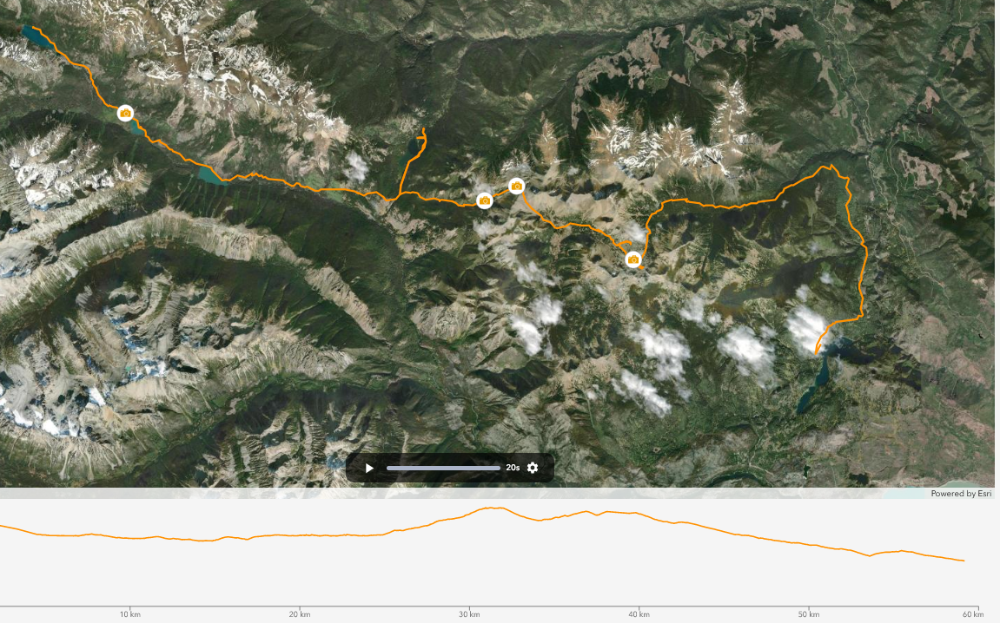

<h1 align="center">

    <br>
        map-routes-v2
    <br>
  <h4 align="center">Map Routes: View GPX Routes Animated</h4>
</h1>

<p align="center">
  <a href="https://github.com/ryansutc/map-routes-v2/actions/workflows/vitest.yml">
    
  </a>
  <a href="https://github.com/ryansutc/map-routes-v2/actions/workflows/playwright.yml">
    
  </a>
</p>

An revised approach example app allowing users to share routes on a map
(based on experiments with [map-routes](https://github.com/ryansutc/map-routes)).
This version built on Django REST Framework backend.

## About

Show and follow along your gpx routes in an ArcGIS map.
This version built on Django REST Framework backend (previous [map-routes](https://github.com/ryansutc/map-routes)).

This is mainly an experiment with **Claude code, AI orchestration and code planning**.

## Running

### Backend Setup

1. Create Python virtual env & install dependencies

```
pipenv init
pipenv install
```

2. Create database and load fixtures (dummy data)

```
cd django_backend
python manage.py migrate
python manage.py loaddata apps/routes/fixtures/sample_routes.json
```

launch: http://localhost:8000/api/schema/swagger-ui

### Frontend Setup

```
pnpm run dev
```

### Try It

https://map-routes-v2.ryansutc.workers.dev

### Inspiration

https://github.com/alexalmansa/TrailReplay
https://www.gpxprofile.com/
